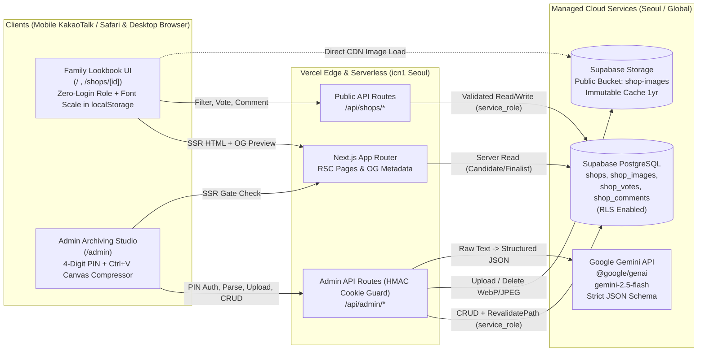
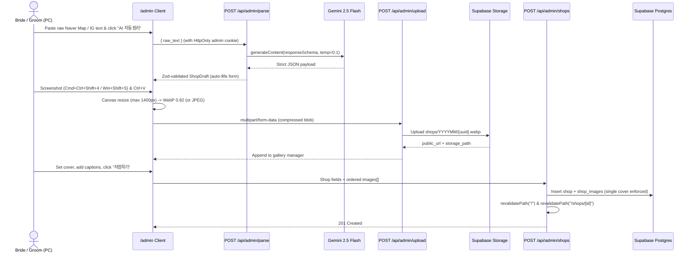

# Honju Lookbook (혼주 룩북) — Product & Technical Specification

> **Document Status:** Authoritative Specification (v1.0)
> **Workflow:** Spec-Driven Development (SDD)
> **Target Deployment:** Vercel (`icn1`, Seoul) + Supabase (`ap-northeast-2`, Seoul) + Google Gemini API (`gemini-2.5-flash`)

---

## 1. Executive Summary & Mobile-First + Desktop-Adaptive UX Philosophy

### 1.1 Product Purpose
**Honju Lookbook (혼주 룩북)** eliminates the friction of switching across Naver Map, Instagram, and fragmented KakaoTalk screenshots when researching wedding parent makeup and hair salons (혼주 메이크업·헤어). The bride and groom curate candidate shops in a high-speed Admin Studio—pasting raw text for Gemini AI structuring and pasting screenshots directly from their clipboard—and share **one clean URL** into the family KakaoTalk chatroom. Both sets of parents and siblings open the link instantly with **zero app install and zero sign-up** to browse curated reference photos, compare pricing and wedding-hall distance, open map navigation, vote on favorites, and leave comments.

### 1.2 Core Design & Platform Philosophy
The application serves two fundamentally different user contexts and adapts its layout accordingly rather than forcing one viewport into the other:

1. **Primary Context — Mobile Web App (`< 768px`) for Parents & Siblings via KakaoTalk**:
   - Engineered to feel like a calm, native editorial magazine app inside **KakaoTalk In-App Browser (iOS/Android)**, **Mobile Safari**, and **Mobile Chrome**.
   - Full dynamic viewport support (`min-h-[100dvh]`), hardware safe-area awareness (`env(safe-area-inset-top)` and `env(safe-area-inset-bottom)`), contained modal/carousel overscroll (`overscroll-behavior: contain`), and mandatory `font-size >= 16px` (`17px` base) on all form controls to prevent iOS Safari auto-zoom.
   - Single-column, one-thumb navigation: compact sticky top bar + bottom-pinned action bar on shop detail pages so `[❤️ 마음에 들어요]` and `[네이버 지도]` remain effortlessly reachable.
   - Senior-first legibility: warm bright palette (strictly no dark mode or low-contrast minimalism), `17px` default body copy, prominent `[가 보통 | 가+ 크게]` `1.2x` global text scaling, `48px+` touch targets, and explicit Korean text labels on every control (never icon-only buttons).

2. **Secondary Context — Graceful Desktop PC Adaptation (`>= 768px`)**:
   - Desktop visitors (parents reviewing on a home PC/tablet, or the couple archiving shops on a laptop) are **never** trapped in a narrow 390px phone column surrounded by empty whitespace, nor subjected to awkwardly stretched mobile cards.
   - The desktop experience sits on a soft Warm Stone outer backdrop (`#F2EFEA`) framing centered, purpose-built editorial layouts:
     - **Lookbook Grid (`/`)**: 2-column editorial magazine grid at `md` (`768px–1279px`), expanding to 3 columns at `xl` (`>= 1280px`) inside a `max-w-[960px]` container (expanding to `xl:max-w-[1120px]` for comfortable 3-column card proportions).
     - **Shop Detail (`/shops/[id]`)**: 2-column Split Editorial Sheet (`max-w-[1040px] mx-auto`) with a sticky left 4:3 reference viewer (arrow buttons, clickable thumbnails, keyboard `←`/`→` navigation, click-to-zoom lightbox with `Esc`) and a scrollable right information & family discussion column.
     - **Admin Studio (`/admin`)**: 2-column Desktop Productivity Workbench (`max-w-[1120px] mx-auto`) optimized for rapid keyboard-first archiving (Left: raw text paste + Gemini Auto-Parse + structured form; Right: dedicated `Ctrl+V` / `Cmd+V` clipboard screenshot zone & gallery manager).

### 1.3 Key Architectural Decisions
| Decision Area | Choice | Rationale |
| :--- | :--- | :--- |
| **Framework** | Next.js 15+ (App Router), React 19, TypeScript (`strict: true`) | Server Components for fast SEO/KakaoTalk OpenGraph previews; Route Handlers for secure server-only keys. Note: `params` and `searchParams` are async `Promise`s in Next.js 15+. |
| **Styling** | Tailwind CSS v4 (`@theme` tokens in `src/app/globals.css`) | Zero-runtime CSS custom properties align seamlessly with dynamic `--font-scale` (`1` vs `1.2`) without layout breakage. |
| **Compute Region** | Vercel Serverless Functions pinned to `icn1` (Seoul) | Co-located with Supabase Seoul (`ap-northeast-2`) for < 30ms DB round-trips and instant image/page loads for Korean users. |
| **Database & Storage** | Supabase PostgreSQL + Public Storage Bucket (`shop-images`) | Permanent image hosting eliminates expiring Instagram CDN hotlinks; relational FKs + unique constraints enforce clean voting and single-cover guarantees. |
| **Write Security Model** | Strict Server-Mediated Writes (`service_role` in Route Handlers only; `anon` RLS is `SELECT`-only) | Prevents direct PostgREST abuse or bypassing Zod validation/PIN auth while keeping public reads simple and safe. |
| **AI Structuring** | `@google/genai` SDK with `gemini-2.5-flash` + strict `responseSchema` | Fast (< 3s), accurate Korean extraction with deterministic JSON schema validated again by Zod before returning to the client. |
| **Image Optimization** | Client-side Canvas resize (`<= 1400px` width) + WebP (`0.82`, JPEG fallback) | Compresses 3–6MB desktop screenshots down to ~120–250KB before upload, saving bandwidth and loading rapidly on parents' mobile data. |
| **Admin Auth** | 4-digit `ADMIN_PIN` verified with constant-time compare + HMAC-SHA256 `HttpOnly` cookie | Zero-friction login for the couple without Supabase Auth overhead; cookie is tamper-proof and inaccessible to client JS. |

---

## 2. System Architecture Diagram

### 2.1 High-Level Component & Data Flow



### 2.2 Clipboard Screenshot & AI Archiving Sequence



---

## 3. Responsive Breakpoint & Layout Blueprint

### 3.1 Breakpoint System
- **Mobile Web App (`< 768px`, Tailwind default)**: Single-column flow on `#FAF8F5` canvas. Tested strictly down to **`360px` viewport width** with `가+ 크게` (`1.2x`) mode active.
- **Tablet / Compact Desktop (`768px – 1279px`, Tailwind `md:` / `lg:`)**: Warm Stone `#F2EFEA` outer backdrop; multi-column adaptive surfaces centered horizontally.
- **Wide Desktop (`>= 1280px`, Tailwind `xl:`)**: Expands list grid to 3 columns while capping detail sheet and admin workbench max widths to preserve optimal reading line length (~60–70 Korean characters per line).

### 3.2 Route-by-Route Layout Rules

#### A. Global Top Navigation Bar (All Public Routes)
| Attribute | Mobile (`< 768px`) | Desktop (`>= 768px`) |
| :--- | :--- | :--- |
| **Position** | `sticky top-0 z-30`, background `rgba(250, 248, 245, 0.94)` with `backdrop-blur-md`, `border-b border-[#EAE5DD]`, `pt-[env(safe-area-inset-top)]`. | Same sticky header spanning full width; inner content aligned to route container (`max-w-[960px]` / `max-w-[1040px]`), `px-6`. |
| **Height** | `min-h-[60px]` (expands naturally if `1.2x` font wraps—never clips). | `min-h-[68px]`. |
| **Left Slot** | On `/`: Brand title `혼주 룩북` (`Noto Serif KR`). On `/shops/[id]`: `[← 목록]` (`min-h-[48px]` touch target) + truncated shop name. | Brand title `혼주 룩북` + subtle subtitle `"양가 어머님·가족을 위한 메이크업 정리"`. On `/shops/[id]`: clear `[← 전체 목록으로]` link above the split sheet. |
| **Right Slot** | Compact row containing: (1) Family Role Pill (`누구신가요?` or `신부측 어머니 ▾`) and (2) Global Font Scale Pill (`[가 보통 \| 가+ 크게]`). If screen width is `<= 380px` in `1.2x` mode, stack Family Role Pill neatly onto a slim secondary utility bar directly below the title bar so neither control truncates or shrinks below `48px` height. | Single horizontal row with generous spacing (`gap-3`): Family Role Pill + Font Scale Pill (`[가 보통 \| 가+ 크게]`) + subtle text link `관리자` pointing to `/admin` (unobtrusive `#5E5A54`). |

#### B. Shop List View (`/`)
| Attribute | Mobile (`< 768px`) | Desktop (`>= 768px`) |
| :--- | :--- | :--- |
| **Canvas & Container** | Full-bleed `#FAF8F5`, `px-4 pt-4 pb-[calc(32px+env(safe-area-inset-bottom))]`. | Outer `#F2EFEA` backdrop; inner container `max-w-[960px] xl:max-w-[1120px] mx-auto px-6 py-8`. |
| **Intro Banner** | Compact warm editorial header: `"어머님·가족 메이크업 후보"` + total count (`총 N곳 정리됨`). | Centered/left-aligned magazine masthead with generous top breathing room and count badge. |
| **Filter Chips Bar** | Horizontal scrollable flex strip (`overflow-x-auto no-scrollbar flex-nowrap gap-2 -mx-4 px-4 py-1`), scroll-snap optional. Chips: `전체`, `샵 방문`, `출장 가능`, `가족 찜 많은 순`. Every chip has `min-h-[48px] px-4 shrink-0`. | Clean flex-wrap bar (`flex-wrap gap-2.5 mb-6`) aligned with grid left edge. No horizontal scrollbar. |
| **Card Grid** | `grid-cols-1 gap-5`. | `md:grid-cols-2 xl:grid-cols-3 gap-6`. |
| **Editorial Card Anatomy** | Pure White (`#FFFFFF`), `rounded-2xl`, `border border-[#EAE5DD]`, shadow `0 2px 12px rgba(31, 29, 26, 0.04)`. Top: `aspect-[4/3]` cover photo (`object-cover`) with optional `★ 최종 후보` pill (top-left). Body (`p-5`): Region & Service Type badges row -> Shop Name (`2-line clamp max`) -> Price Summary (prominent bold `#1F1D1A`) + optional venue distance line -> up to 3 highlight tags (`#태그`) -> Divider -> Footer row (`❤️ N명 찜` on left, `💬 댓글 N` & `자세히 보기 →` on right). | Identical card anatomy with subtle hover elevation (`hover:-translate-y-0.5 hover:shadow-[0_8px_24px_rgba(31,29,26,0.08)] transition-all duration-200`). Cards stretch to uniform row height (`flex flex-col h-full` with footer pushed via `mt-auto`). |

#### C. Shop Detail View (`/shops/[id]`)
| Attribute | Mobile (`< 768px`) | Desktop (`>= 768px`) |
| :--- | :--- | :--- |
| **Outer Layout** | Single-column flow on `#FAF8F5`. Bottom content padding `pb-[calc(96px+env(safe-area-inset-bottom))]` so comments are never covered by the bottom action bar. | Centered **2-Column Split Editorial Sheet** (`max-w-[1040px] mx-auto px-6 py-8`) on `#F2EFEA` backdrop. Main surface is a Pure White (`#FFFFFF`) editorial card (`rounded-3xl border border-[#EAE5DD] p-8`) or cleanly paired white panels (`grid-cols-12 gap-8`). |
| **Photo Gallery** | Full-width edge-to-edge (or `rounded-2xl` inset) `aspect-[4/3]` native CSS scroll-snap carousel (`overflow-x-auto snap-x snap-mandatory`). Floating counter pill (`1 / 6`) at bottom-right. Caption bar directly beneath photo (`bg-[#FAF8F5]` / `#FFFFFF`). Tap any photo to launch Fullscreen Lightbox. | **Left Column (`md:col-span-6`, `md:sticky md:top-[92px] md:self-start`)**: `aspect-[4/3]` stage with large (`48px`) semi-translucent white `<` and `>` arrow buttons, `1 / 6` indicator, caption strip, clickable thumbnail grid (`grid-cols-5 gap-2 mt-3`, active thumb bordered with `2px solid #A68966`), keyboard `ArrowLeft` / `ArrowRight` support (disabled when focused inside input/textarea), and click-to-open Fullscreen Lightbox (`Esc` to close). |
| **Metadata, Maps & Family Discussion** | Flows vertically below the gallery: (1) Title + Status/Area/Service badges, (2) Structured Info Card (Price, Distance from Wedding Hall, Parking, Hours, Address + `[주소 복사]` button), (3) Pros & Cons + Curator Summary Note, (4) Map & Reference Links (`[네이버 지도로 보기]`, `[카카오맵 길찾기]`, optional `[인스타그램 원본 보기]`), (5) Family Voting Card (`[❤️ 여기 마음에 들어요]` + voter names), (6) Family Comments List + Composer. | **Right Column (`md:col-span-6`, independently scrolling with page)**: Same semantic sections in clean editorial vertical rhythm (`space-y-6`). Primary `[❤️ 여기 마음에 들어요]` CTA and map buttons sit prominently near the top of the right column (no bottom-pinned floating bar on desktop). |
| **Bottom-Pinned Action Bar** | **`fixed bottom-0 inset-x-0 z-30 md:hidden`**. Background `rgba(255, 255, 255, 0.96)` with `backdrop-blur-md`, `border-t border-[#EAE5DD]`, `px-4 pt-3 pb-[calc(12px+env(safe-area-inset-bottom))]`. Two `min-h-[52px]` side-by-side buttons: `[❤️ 마음에 들어요 (N)]` (flex-1, Terracotta Rose active state) + `[네이버 지도]` (flex-1, warm charcoal/gold primary action). | Hidden (`md:hidden`); actions are seamlessly integrated inside the Right Column. |
| **Fullscreen Lightbox** | Modal overlay (`fixed inset-0 z-50 bg-[#1F1D1A]/92`, `overscroll-behavior: contain`). Top bar with `1 / 6` counter, `[확대 +]`, `[축소 -]`, and prominent `[닫기 ✕]` button (`min-h-[48px]` with Korean text). Supports touch pinch-zoom / pan and swipe between photos. | Same Lightbox with `<` / `>` arrows, `+` / `-` / `원래 크기` zoom controls, `Esc` close, and `←` / `→` keyboard switching. Caption displayed cleanly at bottom. |

#### D. Admin Archiving Studio (`/admin`)
| Attribute | Mobile (`< 768px`) | Desktop (`>= 768px`) |
| :--- | :--- | :--- |
| **Auth Gate (Unauthenticated)** | Centered card (`max-w-[400px] mx-auto px-4 min-h-[100dvh] flex items-center`) with 4-digit PIN input (`inputMode="numeric"`, `font-size: 24px`, `min-h-[56px]`) and `[관리자 입장하기]` button. | Same centered refined card over `#F2EFEA` backdrop. |
| **Top Workbench Header** | Compact stacked bar: `"관리자 스튜디오"`, `[+ 새 업체]`, `[등록된 업체 목록 (N)]` drawer toggle, `[룩북 보기]`, `[잠금]`. | Single-row header inside `max-w-[1120px] mx-auto`: Title, `[+ 새 업체 등록]`, status filter pills (`전체`, `후보`, `최종후보`, `제외`), `[룩북 열기 ↗]`, `[잠금]`. |
| **Shop Switcher** | Collapsible accordion/drawer listing saved shops with thumbnail, name, status pill, and quick edit tap. | Horizontal scrollable or compact collapsible top strip / sidebar selector showing saved shops with cover thumbnail, name, status badge (`후보` / `최종후보` / `제외`), and instant switching. |
| **Dual-Input Editor** | Single-column stack: (1) AI Raw Text Auto-Parse Box -> (2) Structured Form Fields -> (3) Image Upload & Gallery Manager (uses native mobile photo picker + paste support) -> (4) Sticky Save Footer. | **2-Column Desktop Productivity Workbench (`max-w-[1120px] mx-auto grid md:grid-cols-12 gap-6 items-start`)**: **Left (`md:col-span-7`)** = AI Raw Text Paste + `[✨ AI 자동 정리]` card stacked above Editable Structured Shop Form + Save/Delete bar; **Right (`md:col-span-5 md:sticky md:top-[84px]`)** = Dedicated `Ctrl+V` / `Cmd+V` Clipboard Image Dropzone + Drag-and-Drop + Gallery Grid (Cover selector, Reorder, Caption, Delete). |

---

## 4. Design System Tokens

### 4.1 Color Palette & WCAG AA Contrast Matrix
Strictly bright, airy, modern wedding editorial palette. **Never** use pure black (`#000000`) or dark-mode themes (except the photo lightbox backdrop for image clarity).

| Token Name | Hex / Value | Role & Usage | Contrast Verification |
| :--- | :--- | :--- | :--- |
| `--color-canvas-mobile` | `#FAF8F5` | Mobile page background (Warm Ivory) | Base surface |
| `--color-canvas-desktop` | `#F2EFEA` | Desktop `>=768px` outer backdrop (Soft Warm Stone) | Separates elevated editorial sheets |
| `--color-surface` | `#FFFFFF` | Cards, editorial sheets, inputs, modals | Base card surface |
| `--color-surface-subtle` | `#F7F4EF` | Info rows, caption bars, comment bubbles, badge fills | Soft tonal grouping |
| `--color-border` | `#EAE5DD` | `1px solid` crisp hairline card & section borders | Subtle structural definition |
| `--color-border-strong` | `#D6CEC2` | Input borders, hover borders, inactive pills | Clear input affordance |
| `--color-text-primary` | `#1F1D1A` | Primary headings, body copy, prices (Deep Charcoal) | `16.8:1` on `#FFFFFF`, `15.9:1` on `#FAF8F5` (AAA) |
| `--color-text-secondary` | `#5E5A54` | Metadata labels, addresses, timestamps (Warm Slate) | `6.85:1` on `#FFFFFF`, `6.47:1` on `#FAF8F5` (AA+) |
| `--color-accent-gold` | `#A68966` | Champagne Gold / Warm Taupe — active borders, icons, focus rings, highlight rules | `3.28:1` on `#FFFFFF` (UI/Large Graphics AA) |
| `--color-accent-gold-text` | `#755B3D` | Text-safe dark taupe for small gold text/badges on light tints | `6.15:1` on `#FFFFFF`, `5.6:1` on `#F7F2EB` (AA+) |
| `--color-accent-gold-tint` | `#F7F2EB` | Tinted pill background paired with `--color-accent-gold-text` | Soft editorial highlight |
| `--color-accent-rose` | `#C86D6D` | Soft Terracotta Rose — heart icon, active favorite border | `3.57:1` on `#FFFFFF` (UI/Icon AA) |
| `--color-accent-rose-fill` | `#B55454` | Solid filled active `[❤️ 마음에 들어요]` button background with `#FFFFFF` text | `4.76:1` with `#FFFFFF` text (AA) |
| `--color-accent-rose-text` | `#9E4444` | Text-safe rose for small counts/labels on `#FDF2F2` tint | `5.85:1` on `#FDF2F2` (AA+) |
| `--color-accent-rose-tint` | `#FDF2F2` | Soft rose surface for favorite summary banners & active heart pills | Gentle warmth |
| `--color-accent-sage` | `#4F7A65` | Soft Sage — positive badges (`출장 가능`, `주차 편함`, `최종 후보`) | `4.88:1` on `#FFFFFF` & with `#FFFFFF` text (AA) |
| `--color-accent-sage-text` | `#3B5F4D` | Text-safe sage on `#EEF5F1` badge background | `6.6:1` on `#EEF5F1` (AA+) |
| `--color-accent-sage-tint` | `#EEF5F1` | Positive badge background fill | Clean legibility |
| `--color-danger` | `#B83B3B` | Destructive actions (`삭제`) & validation error text | `5.6:1` on `#FFFFFF` (AA+) |
| `--shadow-card` | `0 2px 12px rgba(31, 29, 26, 0.04)` | Soft diffused default card elevation | Subtle editorial lift |
| `--shadow-card-hover` | `0 8px 24px rgba(31, 29, 26, 0.08)` | Desktop hover elevation | Crisp interactive feedback |

> **Accessibility Rule**: Never render small body/badge text (`< 18px`) directly in raw `#A68966` or `#C86D6D` on `#FFFFFF`. Always pair those brand accents with their AA-verified text/fill companion tokens (`#755B3D`, `#9E4444`, `#B55454`) above.

### 4.2 Typography Stack & Dynamic Scale System
- **Primary UI & Body Font**: `Pretendard Variable` loaded via dynamic Korean unicode-range subset stylesheet (`https://cdn.jsdelivr.net/gh/orioncactus/pretendard@v1.3.9/dist/web/variable/pretendardvariable-dynamic-subset.min.css`) with fallback `'Pretendard', 'Apple SD Gothic Neo', 'Noto Sans KR', sans-serif`.
- **Editorial Display Font**: `Noto Serif KR` loaded via `next/font/google` (`weights: ['500', '600', '700']`, `display: 'swap'`, `variable: '--font-noto-serif-kr'`), used sparingly for the masthead logo (`혼주 룩북`), page headings, and shop detail titles.
- **Korean Line-Breaking Rule**: Apply `word-break: keep-all; overflow-wrap: break-word;` globally on headings, cards, buttons, and body copy so Korean words wrap naturally at spaces without splitting syllables mid-word.

#### Semantic Font Scale Table (`--font-scale: 1` vs `1.2`)
Using CSS custom properties scaled by `--font-scale` guarantees that **all text scales cleanly by exactly `1.2x`** while horizontal container gutters remain compact on `360px` smartphones (preventing narrow column squishing).

| Semantic Token | Usage | Normal (`1.0x`) | Large (`1.2x` / `가+ 크게`) | Line Height | Weight |
| :--- | :--- | :--- | :--- | :--- | :--- |
| `--fs-caption` | Badges, tags, timestamps, helper hints | `14px` | `16.8px` | `1.45` | `500` |
| `--fs-control` | Buttons, chips, nav pills, inputs (`>= 16px` always!) | `16px` | `19.2px` | `1.35` | `600` |
| `--fs-body` | Default body copy, info values, comments | `17px` | `20.4px` | `1.65` | `400` |
| `--fs-body-strong` | Price summary, emphasized metadata | `18px` | `21.6px` | `1.5` | `700` |
| `--fs-card-title` | Shop card title on `/` | `20px` | `24px` | `1.35` | `700` |
| `--fs-section-title` | Detail card section headings (`기본 정보`, `가족 의견`) | `21px` | `25.2px` | `1.35` | `700` |
| `--fs-page-title` | Masthead & Shop Detail H1 (`Noto Serif KR`) | `26px` | `31.2px` | `1.3` | `600` |

### 4.3 Global Font Scale Toggle Mechanics (`[가 보통 | 가+ 크게]`)
1. **Persistence**: Stored in `localStorage` under key `honju_font_scale` with values `"normal"` (default) or `"large"`.
2. **Zero-Flicker Hydration (Anti-FOUC)**: `src/app/layout.tsx` includes a blocking synchronous inline `<script>` inside `<head>` (with `suppressHydrationWarning` on `<html>`):
   ```js
   try {
     var s = localStorage.getItem('honju_font_scale');
     if (s === 'large') document.documentElement.setAttribute('data-font-scale', 'large');
   } catch (e) {}
   ```
3. **CSS Implementation (`src/app/globals.css`)**:
   ```css
   :root {
     --font-scale: 1;
     --fs-caption: calc(14px * var(--font-scale));
     --fs-control: calc(16px * var(--font-scale));
     --fs-body: calc(17px * var(--font-scale));
     --fs-body-strong: calc(18px * var(--font-scale));
     --fs-card-title: calc(20px * var(--font-scale));
     --fs-section-title: calc(21px * var(--font-scale));
     --fs-page-title: calc(26px * var(--font-scale));
   }

   html[data-font-scale="large"] {
     --font-scale: 1.2;
   }
   ```
4. **Overflow Protection Rules**:
   - NEVER place fixed heights (`h-12`, `h-[48px]`) on text-containing elements; ALWAYS use `min-h-[48px]` with vertical padding (`py-2.5`).
   - All button/badge/chip containers allow `flex-wrap` (except horizontally scrollable filter rails).
   - Every interactive control renders a visible Korean label alongside any icon (e.g., `❤️ 마음에 들어요`, `← 목록`, `닫기 ✕`) and meets `min-h-[48px] min-w-[48px]`.

### 4.4 Mobile Web App & Safe-Area Rules
- **Viewport Export (`src/app/layout.tsx`)**:
  ```ts
  export const viewport: Viewport = {
    width: "device-width",
    initialScale: 1,
    viewportFit: "cover",
    themeColor: "#FAF8F5",
  };
  ```
  *(Do NOT set `maximumScale: 1` or `userScalable: false`; pinch-zoom remains enabled for seniors.)*
- **Input Auto-Zoom Prevention**: All `<input>`, `<textarea>`, and `<select>` elements enforce `font-size: max(16px, var(--fs-body))` (`>= 17px` default) so iOS Safari never triggers viewport zoom on focus.
- **Safe-Area Utilities**:
  - Top bar: `padding-top: env(safe-area-inset-top);`
  - Bottom action bar: `padding-bottom: calc(12px + env(safe-area-inset-bottom));`
  - Lightbox top controls: `padding-top: calc(12px + env(safe-area-inset-top));`
- **Scroll Containment**: Apply `overscroll-behavior: contain;` on modals, bottom sheets, lightboxes, and horizontal photo carousels so swiping does not trigger accidental background page bounce or KakaoTalk swipe-back exit.

---

## 5. Database Schema DDL & Storage Bucket Setup

### 5.1 Complete Migration (`supabase/migrations/001_initial_schema.sql`)

```sql
-- ============================================================================
-- Honju Lookbook (혼주 룩북) - Initial PostgreSQL Schema, RLS & Storage Setup
-- Target: Supabase PostgreSQL (ap-northeast-2 Seoul)
-- ============================================================================

CREATE EXTENSION IF NOT EXISTS pgcrypto;

-- ----------------------------------------------------------------------------
-- 1. Core Tables
-- ----------------------------------------------------------------------------

-- 1.1 Candidate Makeup & Hair Shops
CREATE TABLE IF NOT EXISTS public.shops (
  id                  UUID PRIMARY KEY DEFAULT gen_random_uuid(),
  name                TEXT NOT NULL CHECK (char_length(trim(name)) BETWEEN 1 AND 120),
  status              TEXT NOT NULL DEFAULT 'candidate'
                        CHECK (status IN ('candidate', 'finalist', 'excluded')),
  region              TEXT NOT NULL DEFAULT '' CHECK (char_length(region) <= 60),
  address             TEXT NOT NULL DEFAULT '' CHECK (char_length(address) <= 240),
  venue_distance_note TEXT NOT NULL DEFAULT '' CHECK (char_length(venue_distance_note) <= 160),
  service_type        TEXT NOT NULL DEFAULT 'shop'
                        CHECK (service_type IN ('shop', 'onsite', 'both')),
  price_summary       TEXT NOT NULL DEFAULT '' CHECK (char_length(price_summary) <= 160),
  parking_info        TEXT NOT NULL DEFAULT '' CHECK (char_length(parking_info) <= 240),
  business_hours      TEXT NOT NULL DEFAULT '' CHECK (char_length(business_hours) <= 200),
  highlights          TEXT[] NOT NULL DEFAULT '{}'
                        CHECK (coalesce(array_length(highlights, 1), 0) <= 8),
  pros                TEXT NOT NULL DEFAULT '' CHECK (char_length(pros) <= 1000),
  cons                TEXT NOT NULL DEFAULT '' CHECK (char_length(cons) <= 1000),
  summary_note        TEXT NOT NULL DEFAULT '' CHECK (char_length(summary_note) <= 1000),
  naver_map_url       TEXT CHECK (naver_map_url IS NULL OR naver_map_url ~* '^https?://'),
  instagram_url       TEXT CHECK (instagram_url IS NULL OR instagram_url ~* '^https?://'),
  raw_source_text     TEXT,
  created_at          TIMESTAMPTZ NOT NULL DEFAULT now(),
  updated_at          TIMESTAMPTZ NOT NULL DEFAULT now()
);

-- 1.2 Reference Images (Stored in Supabase Storage, never hotlinked)
CREATE TABLE IF NOT EXISTS public.shop_images (
  id            UUID PRIMARY KEY DEFAULT gen_random_uuid(),
  shop_id       UUID NOT NULL REFERENCES public.shops(id) ON DELETE CASCADE,
  storage_path  TEXT NOT NULL UNIQUE,
  public_url    TEXT NOT NULL CHECK (public_url ~* '^https?://'),
  caption       TEXT NOT NULL DEFAULT '' CHECK (char_length(caption) <= 80),
  is_cover      BOOLEAN NOT NULL DEFAULT false,
  sort_order    INTEGER NOT NULL DEFAULT 0 CHECK (sort_order >= 0),
  created_at    TIMESTAMPTZ NOT NULL DEFAULT now()
);

-- 1.3 Family Likes / Votes (1 vote per family role per shop)
CREATE TABLE IF NOT EXISTS public.shop_votes (
  id           UUID PRIMARY KEY DEFAULT gen_random_uuid(),
  shop_id      UUID NOT NULL REFERENCES public.shops(id) ON DELETE CASCADE,
  family_role  TEXT NOT NULL CHECK (
                 family_role IN (
                   '신랑',
                   '신부',
                   '신부측 어머니',
                   '신부측 아버지',
                   '신랑측 어머니',
                   '신랑측 아버지',
                   '형제·자매'
                 )
               ),
  created_at   TIMESTAMPTZ NOT NULL DEFAULT now(),
  CONSTRAINT uq_shop_votes_shop_role UNIQUE (shop_id, family_role)
);

-- 1.4 Family Comments
CREATE TABLE IF NOT EXISTS public.shop_comments (
  id           UUID PRIMARY KEY DEFAULT gen_random_uuid(),
  shop_id      UUID NOT NULL REFERENCES public.shops(id) ON DELETE CASCADE,
  family_role  TEXT NOT NULL CHECK (
                 family_role IN (
                   '신랑',
                   '신부',
                   '신부측 어머니',
                   '신부측 아버지',
                   '신랑측 어머니',
                   '신랑측 아버지',
                   '형제·자매'
                 )
               ),
  content      TEXT NOT NULL CHECK (char_length(trim(content)) BETWEEN 1 AND 500),
  created_at   TIMESTAMPTZ NOT NULL DEFAULT now()
);

-- ----------------------------------------------------------------------------
-- 2. Indexes & Triggers
-- ----------------------------------------------------------------------------

CREATE INDEX IF NOT EXISTS idx_shops_status_created
  ON public.shops (status, created_at DESC);

CREATE INDEX IF NOT EXISTS idx_shops_service_type
  ON public.shops (service_type);

CREATE INDEX IF NOT EXISTS idx_shop_images_shop_sort
  ON public.shop_images (shop_id, sort_order ASC, created_at ASC);

-- Enforce at most ONE cover image per shop at the database level
CREATE UNIQUE INDEX IF NOT EXISTS idx_shop_images_single_cover
  ON public.shop_images (shop_id)
  WHERE (is_cover = true);

CREATE INDEX IF NOT EXISTS idx_shop_votes_shop_id
  ON public.shop_votes (shop_id);

CREATE INDEX IF NOT EXISTS idx_shop_comments_shop_created
  ON public.shop_comments (shop_id, created_at ASC);

-- Auto-update shops.updated_at on UPDATE
CREATE OR REPLACE FUNCTION public.set_updated_at()
RETURNS TRIGGER AS $$
BEGIN
  NEW.updated_at = now();
  RETURN NEW;
END;
$$ LANGUAGE plpgsql;

DROP TRIGGER IF EXISTS trg_shops_set_updated_at ON public.shops;
CREATE TRIGGER trg_shops_set_updated_at
  BEFORE UPDATE ON public.shops
  FOR EACH ROW
  EXECUTE FUNCTION public.set_updated_at();

-- ----------------------------------------------------------------------------
-- 3. Row Level Security (RLS) Policies
-- Design: Public roles (anon/authenticated) are strictly SELECT-only for
-- visible shops ('candidate', 'finalist'). ALL writes (votes, comments, admin
-- CRUD) execute exclusively through Next.js API Routes using service_role
-- after Zod validation and PIN/role verification.
-- ----------------------------------------------------------------------------

ALTER TABLE public.shops ENABLE ROW LEVEL SECURITY;
ALTER TABLE public.shop_images ENABLE ROW LEVEL SECURITY;
ALTER TABLE public.shop_votes ENABLE ROW LEVEL SECURITY;
ALTER TABLE public.shop_comments ENABLE ROW LEVEL SECURITY;

-- Public read of non-excluded shops
DROP POLICY IF EXISTS "public_select_visible_shops" ON public.shops;
CREATE POLICY "public_select_visible_shops"
  ON public.shops
  FOR SELECT
  TO anon, authenticated
  USING (status IN ('candidate', 'finalist'));

-- Public read of images belonging to visible shops
DROP POLICY IF EXISTS "public_select_visible_shop_images" ON public.shop_images;
CREATE POLICY "public_select_visible_shop_images"
  ON public.shop_images
  FOR SELECT
  TO anon, authenticated
  USING (
    EXISTS (
      SELECT 1 FROM public.shops s
      WHERE s.id = shop_images.shop_id
        AND s.status IN ('candidate', 'finalist')
    )
  );

-- Public read of votes belonging to visible shops
DROP POLICY IF EXISTS "public_select_visible_shop_votes" ON public.shop_votes;
CREATE POLICY "public_select_visible_shop_votes"
  ON public.shop_votes
  FOR SELECT
  TO anon, authenticated
  USING (
    EXISTS (
      SELECT 1 FROM public.shops s
      WHERE s.id = shop_votes.shop_id
        AND s.status IN ('candidate', 'finalist')
    )
  );

-- Public read of comments belonging to visible shops
DROP POLICY IF EXISTS "public_select_visible_shop_comments" ON public.shop_comments;
CREATE POLICY "public_select_visible_shop_comments"
  ON public.shop_comments
  FOR SELECT
  TO anon, authenticated
  USING (
    EXISTS (
      SELECT 1 FROM public.shops s
      WHERE s.id = shop_comments.shop_id
        AND s.status IN ('candidate', 'finalist')
    )
  );

-- Note: No INSERT/UPDATE/DELETE policies are granted to anon/authenticated.
-- Supabase service_role bypasses RLS inside server-side Next.js API routes.

-- ----------------------------------------------------------------------------
-- 4. Supabase Storage Bucket & Policies (`shop-images`)
-- ----------------------------------------------------------------------------

INSERT INTO storage.buckets (id, name, public, file_size_limit, allowed_mime_types)
VALUES (
  'shop-images',
  'shop-images',
  true,
  5242880, -- 5 MB hard server limit
  ARRAY['image/webp', 'image/jpeg', 'image/png']
)
ON CONFLICT (id) DO UPDATE
SET
  public = EXCLUDED.public,
  file_size_limit = EXCLUDED.file_size_limit,
  allowed_mime_types = EXCLUDED.allowed_mime_types;

DROP POLICY IF EXISTS "public_read_shop_images_bucket" ON storage.objects;
CREATE POLICY "public_read_shop_images_bucket"
  ON storage.objects
  FOR SELECT
  TO public
  USING (bucket_id = 'shop-images');

-- Uploads and deletions execute exclusively via server-side service_role key
-- through /api/admin/upload and /api/admin/shops/[id].
```

### 5.2 Domain Value Mapping Reference
| DB Field | DB Stored Value | Korean UI Display Label |
| :--- | :--- | :--- |
| `status` | `'candidate'` | `후보` |
| `status` | `'finalist'` | `최종 후보` |
| `status` | `'excluded'` | `제외` *(hidden from public `/`, visible in `/admin`)* |
| `service_type` | `'shop'` | `샵 방문` |
| `service_type` | `'onsite'` | `출장 가능` |
| `service_type` | `'both'` | `샵·출장 모두` |

---

## 6. Exact API Contracts, Security & Gemini JSON Schema

### 6.1 Shared Conventions & Error Envelope
- All API routes live under `src/app/api/**/route.ts` and export `export const preferredRegion = "icn1";` and `export const dynamic = "force-dynamic";`.
- All request bodies and query parameters are validated with **Zod**.
- **Standard Error Response Format**:
  ```json
  {
    "error": {
      "code": "VALIDATION_ERROR",
      "message": "입력 값을 다시 확인해 주세요.",
      "details": {
        "name": ["업체명을 입력해 주세요."]
      }
    }
  }
  ```
- **Shared TypeScript Types (`src/types/shop.ts`)**:
  ```ts
  export const FAMILY_ROLES = [
    "신랑",
    "신부",
    "신부측 어머니",
    "신부측 아버지",
    "신랑측 어머니",
    "신랑측 아버지",
    "형제·자매",
  ] as const;
  export type FamilyRole = (typeof FAMILY_ROLES)[number];

  export type ShopStatus = "candidate" | "finalist" | "excluded";
  export type ServiceType = "shop" | "onsite" | "both";
  export type PublicListFilter = "all" | "shop" | "onsite" | "popular";

  export interface ShopImageDTO {
    id: string;
    storage_path: string;
    public_url: string;
    caption: string;
    is_cover: boolean;
    sort_order: number;
  }

  export interface ShopCommentDTO {
    id: string;
    shop_id: string;
    family_role: FamilyRole;
    content: string;
    created_at: string; // ISO 8601
  }

  export interface ShopListItemDTO {
    id: string;
    name: string;
    status: ShopStatus;
    region: string;
    venue_distance_note: string;
    service_type: ServiceType;
    price_summary: string;
    highlights: string[];
    cover_image: Pick<ShopImageDTO, "public_url" | "caption"> | null;
    image_count: number;
    vote_count: number;
    voters: FamilyRole[];
    comment_count: number;
    created_at: string;
  }

  export interface ShopDetailDTO {
    id: string;
    name: string;
    status: ShopStatus;
    region: string;
    address: string;
    venue_distance_note: string;
    service_type: ServiceType;
    price_summary: string;
    parking_info: string;
    business_hours: string;
    highlights: string[];
    pros: string;
    cons: string;
    summary_note: string;
    naver_map_url: string | null;
    instagram_url: string | null;
    images: ShopImageDTO[];
    vote_count: number;
    voters: FamilyRole[];
    comments: ShopCommentDTO[];
    created_at: string;
    updated_at: string;
  }
  ```

### 6.2 Public API Routes

#### 1. `GET /api/shops`
- **Query Parameters**: `filter?: "all" | "shop" | "onsite" | "popular"` (default `"all"`).
- **Behavior**:
  - Returns only `status IN ('candidate', 'finalist')` (never exposes `raw_source_text` or `excluded` shops).
  - Filter rules:
    - `all`: all visible shops, sorted by `(status === 'finalist' ? 0 : 1) ASC, created_at DESC`.
    - `shop`: `service_type IN ('shop', 'both')`, sorted by finalist first, then `created_at DESC`.
    - `onsite`: `service_type IN ('onsite', 'both')`, sorted by finalist first, then `created_at DESC`.
    - `popular`: all visible shops, sorted by `vote_count DESC, (status === 'finalist' ? 0 : 1) ASC, created_at DESC`.
- **Response (`200 OK`)**:
  ```json
  {
    "shops": [
      {
        "id": "550e8400-e29b-41d4-a716-446655440000",
        "name": "청담 아뜰리에 메이크업",
        "status": "finalist",
        "region": "강남·청담",
        "venue_distance_note": "식장까지 차로 15분",
        "service_type": "both",
        "price_summary": "1인 22~25만원 (헤어+메이크업)",
        "highlights": ["한복올림머리", "자연스러운피부", "출장가능"],
        "cover_image": {
          "public_url": "https://<project>.supabase.co/storage/v1/object/public/shop-images/shops/202611/abc.webp",
          "caption": "어머님 한복 올림머리"
        },
        "image_count": 6,
        "vote_count": 3,
        "voters": ["신부측 어머니", "신부", "신랑"],
        "comment_count": 2,
        "created_at": "2026-11-20T05:00:00.000Z"
      }
    ],
    "total": 1
  }
  ```

#### 2. `GET /api/shops/[id]`
- **Validation**: `id` must be a valid UUID (`400` if invalid).
- **Behavior**: Fetches shop where `id = $1 AND status IN ('candidate', 'finalist')` along with ordered `images` (`sort_order ASC`), `voters`, and chronological `comments` (`created_at ASC`). Returns `404` if not found or excluded.
- **Response (`200 OK`)**: `{ "shop": ShopDetailDTO }`.

#### 3. `POST /api/shops/[id]/vote`
- **Purpose**: Toggle a family member's like on a shop.
- **Request Body**:
  ```json
  {
    "family_role": "신부측 어머니"
  }
  ```
- **Behavior**:
  - Validates `id` (UUID) and `family_role` (strictly within `FAMILY_ROLES`).
  - Verifies shop exists and is visible (`candidate` or `finalist`), else `404`.
  - If `(shop_id, family_role)` exists in `shop_votes`, deletes it (`voted: false`); otherwise inserts it (`voted: true`).
  - Queries updated voter list for the shop.
- **Response (`200 OK`)**:
  ```json
  {
    "shop_id": "550e8400-e29b-41d4-a716-446655440000",
    "family_role": "신부측 어머니",
    "voted": true,
    "vote_count": 4,
    "voters": ["신랑", "신부", "신부측 어머니", "신랑측 어머니"]
  }
  ```

#### 4. `POST /api/shops/[id]/comments`
- **Request Body**:
  ```json
  {
    "family_role": "신부측 어머니",
    "content": "올림머리 볼륨이 과하지 않고 단아하네요."
  }
  ```
- **Validation**: `family_role` in `FAMILY_ROLES`; `content.trim()` length `1..500`. Verifies visible shop exists (`404`).
- **Response (`201 Created`)**:
  ```json
  {
    "comment": {
      "id": "770e8400-e29b-41d4-a716-446655440001",
      "shop_id": "550e8400-e29b-41d4-a716-446655440000",
      "family_role": "신부측 어머니",
      "content": "올림머리 볼륨이 과하지 않고 단아하네요.",
      "created_at": "2026-11-20T06:12:00.000Z"
    }
  }
  ```

#### 5. `DELETE /api/shops/[id]/comments/[commentId]`
- **Authorization Rule**:
  - Accepts `?family_role=<URL-encoded FamilyRole>` query parameter (preferred over `DELETE` body for proxy compatibility).
  - Deletion is permitted if EITHER (a) the caller holds a valid `honju_admin_session` cookie, OR (b) `query.family_role === comment.family_role`.
  - Otherwise returns `403 Forbidden` (`"본인이 작성한 의견만 삭제할 수 있어요."`).
- **Response (`200 OK`)**: `{ "deleted": true, "id": "<commentId>" }`.

---

### 6.3 Admin Security & API Routes

#### Admin Session Cookie Specification (`src/lib/admin-auth.ts`)
- **Cookie Name**: `honju_admin_session`
- **Token Structure**: Stateless signed payload: `${base64url(JSON.stringify({ sub: "admin", iat, exp }))}.${base64url(HMAC_SHA256(payloadB64, ADMIN_SESSION_SECRET))}`
- **TTL**: 7 days (`604800` seconds).
- **Cookie Flags**: `httpOnly: true`, `sameSite: "lax"`, `secure: process.env.NODE_ENV === "production"`, `path: "/"`, `maxAge: 604800`.
- **PIN Comparison**: Hash both submitted `pin` and `process.env.ADMIN_PIN` with SHA-256 and compare digests using `crypto.timingSafeEqual` (eliminates length & timing side channels).
- **Brute-Force Mitigation**: Track failed attempts per client IP (`x-forwarded-for` first hop) in a module-level map (max 5 failures per 15 minutes -> `429 Too Many Requests`), plus a `400ms` artificial delay on wrong PIN.
- **Guard Helper**: `requireAdminSession()` returns `boolean`; every `/api/admin/*` route (except `/api/admin/auth`) returns `401 Unauthorized` (`{ error: { code: "UNAUTHORIZED", message: "관리자 인증이 필요합니다." } }`) when invalid/expired.

#### 1. `GET /api/admin/auth` | `POST /api/admin/auth` | `DELETE /api/admin/auth`
- `GET`: Returns `{ "authenticated": boolean }`.
- `POST`: Request `{ "pin": "1234" }` (`^\d{4}$`). On match, sets `honju_admin_session` cookie and returns `200 { "authenticated": true }`. On mismatch, returns `401 { error: { code: "INVALID_PIN", message: "비밀번호가 일치하지 않습니다." } }`.
- `DELETE`: Clears cookie (`maxAge: 0`), returns `200 { "authenticated": false }`.

#### 2. `POST /api/admin/parse` (Gemini AI Structuring Engine)
- **Auth**: Admin cookie required.
- **Request Body**:
  ```json
  {
    "raw_text": "청담 OO 메이크업...\n혼주 헤어+메이크업 1인 24만원\n발렛 5,000원, 새벽 5시부터 가능..."
  }
  ```
- **Validation**: `raw_text.trim()` length `10..15000` characters.
- **Server Implementation (`@google/genai`)**:
  - Client: `new GoogleGenAI({ apiKey: process.env.GEMINI_API_KEY })`
  - Model: `"gemini-2.5-flash"`
  - Config: `temperature: 0.1`, `responseMimeType: "application/json"`, `responseSchema` defined using `Type` from `@google/genai`:
    ```ts
    const shopParseResponseSchema = {
      type: Type.OBJECT,
      properties: {
        name: {
          type: Type.STRING,
          description: "업체명(살롱/메이크업샵 이름). 텍스트에 없으면 빈 문자열.",
        },
        region: {
          type: Type.STRING,
          description: "간결한 지역명 (예: '강남·청담', '잠실·송파', '서초·반포'). 없으면 빈 문자열.",
        },
        address: {
          type: Type.STRING,
          description: "도로명 또는 지번 주소. 없으면 빈 문자열.",
        },
        price_summary: {
          type: Type.STRING,
          description: "혼주 기준 예상 가격 요약 (예: '1인 22~25만원 (헤어+메이크업)'). 없으면 빈 문자열.",
        },
        service_type: {
          type: Type.STRING,
          enum: ["shop", "onsite", "both"],
          description: "'shop'(샵 방문), 'onsite'(출장 전용), 'both'(샵 방문 및 출장 모두 가능). 언급 없으면 'shop'.",
        },
        parking_info: {
          type: Type.STRING,
          description: "주차 가능 여부, 발렛 비용, 무료 시간 등. 없으면 빈 문자열.",
        },
        business_hours: {
          type: Type.STRING,
          description: "영업시간 및 새벽 예약 가능 여부. 없으면 빈 문자열.",
        },
        highlights: {
          type: Type.ARRAY,
          items: { type: Type.STRING },
          description: "핵심 특징 짧은 한국어 태그 3~5개 (앞에 '#' 기호 제외, 각 2~10자. 예: '한복올림머리', '자연스러운피부', '새벽예약').",
        },
        pros: {
          type: Type.STRING,
          description: "혼주(부모님) 관점에서의 장점 1~3문장. 텍스트에 근거한 내용만 작성.",
        },
        cons: {
          type: Type.STRING,
          description: "주의할 점/아쉬운 점 1~2문장 (예약 마감 빠름, 주차비 등). 텍스트에 없으면 빈 문자열(지어내지 말 것).",
        },
        summary_note: {
          type: Type.STRING,
          description: "50~70대 부모님이 읽기 편한 정중하고 따뜻한 한두 문장 요약.",
        },
      },
      required: [
        "name",
        "region",
        "address",
        "price_summary",
        "service_type",
        "parking_info",
        "business_hours",
        "highlights",
        "pros",
        "cons",
        "summary_note",
      ],
    };
    ```
  - **System Instruction Rules**:
    1. Extract strictly from the provided raw Naver Map / Instagram / blog text. **Never fabricate** prices, addresses, or negative reviews; return `""` when absent.
    2. Strip hashtags, emojis, and promotional clutter. Ensure `highlights` contains 3–5 concise Korean phrases without leading `#`.
    3. Use clear, polite Korean (`해요체`) readable by parents in their 50s–70s.
  - **Bonus URL Auto-Detection (Server Regex Helper)**: Alongside Gemini, run lightweight regex extraction on `raw_text` to detect any `naver.me` / `map.naver.com` URL (`detected_naver_map_url`) and `instagram.com` URL (`detected_instagram_url`) so the form can pre-populate them when empty.
  - Post-parse validation via Zod (strips leading `#` from tags, trims strings, clamps array to max 5 items).
- **Response (`200 OK`)**:
  ```json
  {
    "parsed": {
      "name": "청담 아뜰리에 메이크업",
      "region": "강남·청담",
      "address": "서울 강남구 선릉로 123 3층",
      "price_summary": "1인 24만원 (헤어+메이크업)",
      "service_type": "both",
      "parking_info": "발렛파킹 5,000원 (2시간)",
      "business_hours": "매일 05:00 - 18:00 (새벽 예약 가능)",
      "highlights": ["한복올림머리", "자연스러운피부", "새벽예약", "단독룸"],
      "pros": "어머님 한복 올림머리 볼륨이 자연스럽고 단독 룸에서 조용히 진행할 수 있어요.",
      "cons": "주말 새벽 시간대는 2개월 전 예약 마감이 빠른 편이에요.",
      "summary_note": "단아한 한복 헤어와 차분한 메이크업으로 어머님들 만족도가 높은 청담 샵이에요.",
      "detected_naver_map_url": "https://naver.me/example",
      "detected_instagram_url": null
    }
  }
  ```

#### 3. `POST /api/admin/upload` & `DELETE /api/admin/upload`
- **`POST /api/admin/upload`**:
  - Auth: Admin cookie required.
  - Content-Type: `multipart/form-data` with single field `file`.
  - Validation:
    - File size `<= 5 * 1024 * 1024` (5MB).
    - Verify MIME type AND file magic bytes (`image/webp`: `RIFF....WEBP`, `image/jpeg`: `FF D8 FF`, `image/png`: `89 50 4E 47`). Reject spoofed uploads with `400`.
  - Storage Key: `shops/${YYYYMM}/${crypto.randomUUID()}.${ext}` uploaded via `supabaseAdmin.storage.from("shop-images").upload(path, buffer, { contentType, cacheControl: "31536000", upsert: false })`.
  - Response (`201 Created`):
    ```json
    {
      "storage_path": "shops/202611/9b1deb4d-3b7d-4bad-9bdd-2b0d7b3dcb6d.webp",
      "public_url": "https://<project>.supabase.co/storage/v1/object/public/shop-images/shops/202611/9b1deb4d-3b7d-4bad-9bdd-2b0d7b3dcb6d.webp",
      "content_type": "image/webp",
      "size_bytes": 184320
    }
    ```
- **`DELETE /api/admin/upload`**:
  - Auth: Admin cookie required.
  - Request Body: `{ "storage_path": "shops/202611/....webp" }`.
  - Validation: Must strictly match `/^shops\/\d{6}\/[0-9a-f-]{36}\.(webp|jpg|jpeg|png)$/` (prevents arbitrary deletion/path traversal).
  - Behavior: Deletes the file from `shop-images` bucket (used when admin removes a freshly pasted unsaved draft image). Returns `200 { "deleted": true }`.

#### 4. `GET /api/admin/shops`
- Auth: Admin cookie required.
- Returns all shops across ALL statuses (`candidate`, `finalist`, `excluded`) including `raw_source_text`, full `images[]`, `vote_count`, and `comment_count`, ordered by `updated_at DESC`.
- Response (`200 OK`): `{ "shops": AdminShopDetailDTO[] }`.

#### 5. `POST /api/admin/shops`
- Auth: Admin cookie required.
- Request Body:
  ```json
  {
    "name": "청담 아뜰리에 메이크업",
    "status": "candidate",
    "region": "강남·청담",
    "address": "서울 강남구 선릉로 123 3층",
    "venue_distance_note": "식장까지 차로 15분",
    "service_type": "both",
    "price_summary": "1인 24만원",
    "parking_info": "발렛 5,000원",
    "business_hours": "05:00 - 18:00",
    "highlights": ["한복올림머리", "자연스러운피부"],
    "pros": "...",
    "cons": "...",
    "summary_note": "...",
    "naver_map_url": "https://naver.me/example",
    "instagram_url": "https://instagram.com/example",
    "raw_source_text": "...",
    "images": [
      {
        "storage_path": "shops/202611/abc.webp",
        "public_url": "https://.../abc.webp",
        "caption": "어머님 한복 올림머리",
        "is_cover": true,
        "sort_order": 0
      }
    ]
  }
  ```
- Normalization Rules:
  - Empty string URLs (`""`) are normalized to `null` before DB insert.
  - If `images.length > 0` and none has `is_cover: true`, automatically set `images[0].is_cover = true`; if multiple have `is_cover: true`, retain only the first so `idx_shop_images_single_cover` never fails.
  - Reassigns `sort_order` sequentially (`0, 1, 2, ...`).
  - Calls `revalidatePath("/")` and `revalidatePath(`/shops/${created.id}`)`.
- Response (`201 Created`): `{ "shop": AdminShopDetailDTO }`.

#### 6. `PATCH /api/admin/shops/[id]`
- Auth: Admin cookie required.
- Request Body: Partial shop metadata fields + optional full `images[]` array.
- Image Reconciliation Strategy (when `images` is provided):
  1. Fetch existing `shop_images` rows for `shop_id`.
  2. Identify removed `storage_path` entries (present in DB, absent from incoming `images`).
  3. Clear `is_cover = false` (or delete & re-insert ordered `shop_images` rows cleanly so `idx_shop_images_single_cover` and `storage_path UNIQUE` never collide during reordering).
  4. Best-effort delete removed `storage_path` objects from Supabase Storage (`shop-images` bucket).
  5. Call `revalidatePath("/")` and `revalidatePath(`/shops/${id}`)`.
- Response (`200 OK`): `{ "shop": AdminShopDetailDTO }`.

#### 7. `DELETE /api/admin/shops/[id]`
- Auth: Admin cookie required.
- Behavior:
  1. Fetch all `storage_path` values from `shop_images` where `shop_id = id`.
  2. Delete shop row from `public.shops` (`ON DELETE CASCADE` removes `shop_images`, `shop_votes`, `shop_comments`).
  3. Remove all fetched `storage_path` files from Supabase Storage (`shop-images`).
  4. Call `revalidatePath("/")` and `revalidatePath(`/shops/${id}`)`.
- Response (`200 OK`): `{ "deleted": true, "id": "<id>" }`.

### 6.4 Environment Variables (`.env.example`)
```env
# Supabase Public Configuration (safe for client & next/image hostname)
NEXT_PUBLIC_SUPABASE_URL=https://your-project-ref.supabase.co
NEXT_PUBLIC_SUPABASE_ANON_KEY=your-supabase-anon-key

# Supabase Server-Only Admin Key (NEVER prefix with NEXT_PUBLIC_)
SUPABASE_SERVICE_ROLE_KEY=your-supabase-service-role-key

# Google Gemini API Key (Server-Only, used with @google/genai)
GEMINI_API_KEY=your-gemini-api-key

# Admin Studio Security (Server-Only)
ADMIN_PIN=1234
ADMIN_SESSION_SECRET=replace-with-64-hex-chars-from-openssl-rand-hex-32

# Canonical Production URL (used for KakaoTalk OpenGraph preview metadata)
NEXT_PUBLIC_SITE_URL=https://honju-lookbook.vercel.app
```

---

## 7. Frontend Route & Component Hierarchy Tree

### 7.1 Directory & File Structure (`src/`)
```text
src/
├── app/
│   ├── layout.tsx                       # Root layout: Pretendard + Noto Serif KR, anti-FOUC script, Providers, OG defaults
│   ├── globals.css                      # Tailwind v4 @theme tokens, --font-scale system, safe-area & keep-all rules
│   ├── page.tsx                         # Public Shop List (/) — RSC initial data fetch + ShopLookbookClient
│   ├── shops/
│   │   └── [id]/
│   │       ├── page.tsx                 # Public Shop Detail (/shops/[id]) — RSC + dynamic generateMetadata (KakaoTalk OG)
│   │       └── not-found.tsx            # Warm Korean 404 screen with [전체 목록으로 돌아가기]
│   ├── admin/
│   │   └── page.tsx                     # Admin Studio (/admin) — RSC session check -> PinGate or AdminWorkbench
│   └── api/
│       ├── shops/
│       │   ├── route.ts                 # GET /api/shops
│       │   └── [id]/
│       │       ├── route.ts             # GET /api/shops/[id]
│       │       ├── vote/route.ts        # POST /api/shops/[id]/vote
│       │       └── comments/
│       │           ├── route.ts         # POST /api/shops/[id]/comments
│       │           └── [commentId]/
│       │               └── route.ts     # DELETE /api/shops/[id]/comments/[commentId]
│       └── admin/
│           ├── auth/route.ts            # GET, POST, DELETE /api/admin/auth
│           ├── parse/route.ts           # POST /api/admin/parse
│           ├── upload/route.ts          # POST, DELETE /api/admin/upload
│           └── shops/
│               ├── route.ts             # GET, POST /api/admin/shops
│               └── [id]/route.ts        # PATCH, DELETE /api/admin/shops/[id]
├── components/
│   ├── providers/
│   │   ├── FontScaleProvider.tsx        # localStorage 'honju_font_scale' + <html data-font-scale> sync
│   │   └── FamilyIdentityProvider.tsx   # localStorage 'honju_family_role' + global identity selector modal trigger
│   ├── layout/
│   │   ├── PublicHeader.tsx             # Sticky compact header, Role Pill, [가 보통 | 가+ 크게] toggle
│   │   ├── FontScaleToggle.tsx          # Accessible 48px+ segmented pill [가 보통 | 가+ 크게]
│   │   └── FamilyIdentityModal.tsx      # Mobile Bottom Sheet / Desktop Modal with 7 role buttons + pending-action resume
│   ├── lookbook/
│   │   ├── ShopLookbookClient.tsx       # Filter bar state + URL sync + responsive 1/2/3-col editorial grid
│   │   ├── FilterChipBar.tsx            # 전체 / 샵 방문 / 출장 가능 / 가족 찜 많은 순
│   │   ├── ShopCard.tsx                 # Editorial card (4:3 cover, badges, price, 3 tags, likes, comments)
│   │   └── EmptyLookbookState.tsx       # Warm Korean empty state per filter
│   ├── detail/
│   │   ├── ShopDetailView.tsx           # Orchestrates Mobile flow vs Desktop 2-col Split Editorial Sheet
│   │   ├── PhotoGalleryViewer.tsx       # Mobile swipe carousel + Desktop arrows/thumbnails/keyboard nav
│   │   ├── PhotoLightbox.tsx            # Fullscreen zoomable viewer (pinch/button zoom, Esc, Korean Close button)
│   │   ├── ShopInfoCard.tsx             # Price, wedding hall distance, parking, hours, address + [주소 복사]
│   │   ├── MapActionButtons.tsx         # [네이버 지도로 보기], [카카오맵 길찾기], [인스타그램 원본 보기]
│   │   ├── FamilyVotePanel.tsx          # [❤️ 여기 마음에 들어요] optimistic toggle + voter summary sentence
│   │   ├── FamilyCommentSection.tsx     # Comment list, composer (>=17px textarea), role-guarded delete
│   │   └── MobileBottomActionBar.tsx    # Mobile-only pinned bar: [❤️ 마음에 들어요] + [네이버 지도]
│   └── admin/
│       ├── AdminPinGate.tsx             # 4-digit numeric PIN screen + error/lockout feedback
│       ├── AdminWorkbench.tsx           # 2-col Desktop / 1-col Mobile layout + Shop Switcher & CRUD state
│       ├── AdminShopListBar.tsx         # Saved shop selector with status filter tabs (후보/최종후보/제외)
│       ├── AiTextParserBox.tsx          # Raw text textarea + [✨ AI 자동 정리] trigger & field-fill toast
│       ├── AdminShopForm.tsx            # Editable structured fields + interactive highlight tag chip editor
│       ├── ClipboardImageUploader.tsx   # Window paste listener + drag/drop + file picker + Canvas WebP/JPEG compressor
│       └── AdminGalleryManager.tsx      # Image grid: Cover badge/button, Reorder ↑/↓, Caption input, Delete
├── lib/
│   ├── supabase/
│   │   ├── server.ts                    # Server-only supabasePublic (anon) & supabaseAdmin (service_role) factories
│   │   └── queries.ts                   # Shared DB query & DTO aggregation helpers (shops + cover + counts)
│   ├── admin-auth.ts                    # HMAC-SHA256 cookie sign/verify, constant-time PIN check, IP throttle
│   ├── gemini.ts                        # @google/genai client, responseSchema, systemInstruction, URL extractor
│   ├── image-compress.ts                # Browser Canvas resize (<=1400px) -> WebP/JPEG 0.82 blob compressor
│   ├── map-links.ts                     # Safe Naver Map & KakaoMap HTTPS search/deep-link builders
│   └── validators.ts                    # Shared Zod schemas for shops, images, votes, comments, parse input
└── types/
    └── shop.ts                          # Canonical domain interfaces & FAMILY_ROLES constant
```

### 7.2 Component Interaction & Key UX Flows
1. **Seamless Zero-Login Action Resume**:
   - `FamilyIdentityProvider` exposes `requireRole(onSelected: (role: FamilyRole) => void)`.
   - If a parent taps `[❤️ 여기 마음에 들어요]` or `[댓글 등록]` before choosing a role, `FamilyIdentityModal` opens immediately with large 48px+ buttons for the 7 roles. The instant they tap e.g. `신부측 어머니`, the modal closes, saves to `localStorage`, and **automatically executes** the pending vote or comment submission.
2. **Client-Side Clipboard Image Compression (`src/lib/image-compress.ts`)**:
   - `ClipboardImageUploader` attaches a `window.addEventListener("paste", handler)` while the Admin Workbench is mounted.
   - If `event.clipboardData.items` contains one or more items with `type.startsWith("image/")`, call `event.preventDefault()` and process each image sequentially (keeping plain-text paste into form inputs completely unaffected!).
   - Compression pipeline:
     1. Decode via `createImageBitmap(file)` (fallback: `URL.createObjectURL` + `HTMLImageElement`).
     2. Target dimensions: if `width > 1400`, scale down to `width = 1400`, `height = Math.round(height * (1400 / width))`; never upscale.
     3. Draw onto offscreen `<canvas>` with white background fill (prevents black artifacts if transparent PNG falls back to JPEG).
     4. Export via `canvas.toBlob(cb, "image/webp", 0.82)`; if resulting `blob.type !== "image/webp"`, retry with `"image/jpeg"` at `0.82`. If `blob.size > 2 * 1024 * 1024`, re-encode once at quality `0.72`.
     5. Upload immediately via `POST /api/admin/upload` and show per-card upload progress skeleton until complete.
3. **External Map Link Fallback (`src/lib/map-links.ts`)**:
   - Naver Map button: uses `shop.naver_map_url` if valid; otherwise builds `https://map.naver.com/p/search/${encodeURIComponent(shop.address || shop.name)}`.
   - KakaoMap button: builds `https://map.kakao.com/link/search/${encodeURIComponent(shop.address || shop.name)}`.
   - All external links use `target="_blank" rel="noopener noreferrer"` for predictable behavior in KakaoTalk in-app browsers and desktop tabs.

---

## 8. Phased Implementation Plan & Acceptance Criteria

### Phase 1: Project Foundation, Design System & Database Setup
**Scope**:
1. Initialize Next.js 15+ (App Router, TypeScript strict, Tailwind CSS v4) with `vercel.json` (`"regions": ["icn1"]`) and `next.config.ts` (`images.remotePatterns` configured for Supabase Storage `*.supabase.co`).
2. Implement `src/app/globals.css` with all Section 4 color tokens, `--font-scale` typography variables, safe-area helpers, and `word-break: keep-all`.
3. Configure `src/app/layout.tsx` with `Pretendard Variable` dynamic subset, `Noto Serif KR` (`next/font/google`), anti-FOUC `<head>` font-scale script, `viewportFit: "cover"`, and base Korean OpenGraph metadata.
4. Create `supabase/migrations/001_initial_schema.sql`, `.env.example`, `src/types/shop.ts`, `src/lib/validators.ts`, `src/lib/supabase/server.ts`, and `src/lib/supabase/queries.ts`.

**Acceptance Criteria (AC-1)**:
- [ ] `npm run typecheck` (`tsc --noEmit`) and `npm run build` pass with zero errors.
- [ ] Running `001_initial_schema.sql` on Supabase succeeds idempotently (running it twice throws zero errors) and creates all 4 tables, indexes, `trg_shops_set_updated_at`, RLS policies, and the public `shop-images` bucket.
- [ ] Attempting direct `INSERT` into `shops`, `shop_votes`, or `shop_comments` using the `anon` key is rejected by RLS; `SELECT` on `excluded` shops using `anon` returns 0 rows.
- [ ] Toggling `data-font-scale="large"` on `<html>` scales all typography cleanly by `1.2x` with zero flash on page reload.

---

### Phase 2: Admin Security, Image Upload & Gemini AI API Layer
**Scope**:
1. Build `src/lib/admin-auth.ts` (constant-time PIN verification, HMAC-SHA256 signed `HttpOnly` cookie, IP brute-force throttle).
2. Implement `GET/POST/DELETE /api/admin/auth`.
3. Build `src/lib/gemini.ts` (`@google/genai`, `gemini-2.5-flash`, strict `responseSchema`, URL regex extractor) and `POST /api/admin/parse`.
4. Implement `POST/DELETE /api/admin/upload` with MIME + magic-byte validation and Supabase Storage `shop-images` integration.
5. Implement `GET/POST /api/admin/shops` and `PATCH/DELETE /api/admin/shops/[id]` with atomic image reconciliation, Storage cleanup on removal/delete, and `revalidatePath`.

**Acceptance Criteria (AC-2)**:
- [ ] All `/api/admin/*` endpoints (except `/api/admin/auth`) return `401` without a valid signed cookie and reject tampered cookies.
- [ ] `POST /api/admin/auth` sets `HttpOnly; SameSite=Lax; Path=/` cookie on valid `ADMIN_PIN`, returns `401` on wrong PIN, and returns `429` after 5 consecutive failures from the same IP.
- [ ] `POST /api/admin/parse` transforms messy pasted Naver Map / Instagram Korean text into valid JSON matching all 11 required fields without fabricating missing data.
- [ ] `POST /api/admin/upload` rejects files > 5MB or non-image magic bytes (`400`), and returns a directly accessible Supabase public URL for valid WebP/JPEG/PNG uploads.
- [ ] Deleting a shop via `DELETE /api/admin/shops/[id]` removes DB rows (cascading images/votes/comments) AND removes all associated image files from `shop-images` storage.

---

### Phase 3: Admin Archiving Studio UI (`/admin`)
**Scope**:
1. Build `AdminPinGate.tsx` (4-digit numeric keypad-friendly input, >= 24px font size, clear Korean error messaging).
2. Build `AdminWorkbench.tsx` adopting the 2-column Desktop Productivity Workbench (`>= 768px`, `max-w-[1120px]`) and single-column Mobile flow (`< 768px`).
3. Implement `AiTextParserBox.tsx`, `AdminShopForm.tsx` (including interactive tag chip editor and status selector `후보` / `최종후보` / `제외`), and `AdminShopListBar.tsx`.
4. Build `src/lib/image-compress.ts`, `ClipboardImageUploader.tsx` (`Ctrl+V` / `Cmd+V` smart image-only paste interception + drag-and-drop + file picker), and `AdminGalleryManager.tsx` (`대표 사진 지정`, reorder `↑`/`↓`, caption input, delete).

**Acceptance Criteria (AC-3)**:
- [ ] Visiting `/admin` unauthenticated renders the PIN gate; entering `ADMIN_PIN` opens the Workbench and persists across page refreshes.
- [ ] Pasting raw text into the AI box and clicking `[✨ AI 자동 정리]` populates form fields without overwriting already-uploaded images; all fields remain freely editable before save.
- [ ] Copying a desktop screenshot and pressing `Ctrl+V` / `Cmd+V` anywhere in `/admin` compresses the image client-side (`width <= 1400px`, WebP/JPEG `0.82`), uploads it to Supabase Storage, and appends it to the gallery while normal text paste into inputs continues working normally.
- [ ] Admin can set a cover photo (only one active at a time), reorder photos, edit captions, change shop status (`후보` / `최종후보` / `제외`), save updates, and delete shops with confirmation.

---

### Phase 4: Public Family Lookbook, Detail Sheet & Voting/Comments
**Scope**:
1. Implement public APIs: `GET /api/shops`, `GET /api/shops/[id]`, `POST /api/shops/[id]/vote`, `POST /api/shops/[id]/comments`, `DELETE /api/shops/[id]/comments/[commentId]`.
2. Build `FontScaleProvider`, `FamilyIdentityProvider`, `PublicHeader`, `FontScaleToggle`, and `FamilyIdentityModal`.
3. Build `/` (`ShopLookbookClient`, `FilterChipBar`, `ShopCard`, `EmptyLookbookState`) transitioning from 1-col mobile to 2-col `md` / 3-col `xl` editorial grid on `#F2EFEA` desktop backdrop.
4. Build `/shops/[id]` (`ShopDetailView`, `PhotoGalleryViewer`, `PhotoLightbox`, `ShopInfoCard`, `MapActionButtons`, `FamilyVotePanel`, `FamilyCommentSection`, `MobileBottomActionBar`).

**Acceptance Criteria (AC-4)**:
- [ ] `/` loads published shops (`candidate` & `finalist` only; `excluded` shops never appear) and filters accurately across `전체`, `샵 방문`, `출장 가능`, and `가족 찜 많은 순` with URL query sync.
- [ ] Tapping `[❤️ 여기 마음에 들어요]` or submitting a comment without a selected role opens the 7-role selector and automatically completes the vote/comment right after role selection.
- [ ] Each family role can toggle at most 1 vote per shop (`uq_shop_votes_shop_role`), voter names render cleanly (e.g., `"신부측 어머니, 신부님이 좋아해요"`), and a family member can delete their own role's comment (with confirmation) but receives `403` if attempting to delete another role's comment.
- [ ] On mobile (`< 768px`), `/shops/[id]` displays a touch-swipeable 4:3 carousel (`1 / N`) and a safe-area-padded bottom-pinned action bar (`[❤️ 마음에 들어요]` + `[네이버 지도]`).
- [ ] On desktop (`>= 768px`), `/shops/[id]` renders the 2-column Split Editorial Sheet (`max-w-[1040px]`) with sticky left viewer, `<`/`>` buttons, thumbnail strip, `←`/`→` keyboard navigation, and click-to-zoom Lightbox (`Esc` to close), with the mobile bottom bar hidden.

---

### Phase 5: Senior Accessibility Audit, KakaoTalk Polish & Vercel Deployment
**Scope**:
1. Implement dynamic `generateMetadata` on `/` and `/shops/[id]` with Korean title, summary, and shop cover `og:image` for KakaoTalk link preview cards.
2. Conduct full visual & accessibility audit across `360px` (small Android), `390px` (iPhone), `768px` (tablet), and `1440px` (desktop) in **both `가 보통` and `가+ 크게` (`1.2x`) modes**.
3. Verify loading skeletons, empty states, error boundaries, address copy toast, and graceful fallback when a shop has 0 images or optional URLs (`instagram_url`, `naver_map_url`) omitted.
4. Deploy to Vercel (`icn1`), configure all production environment variables, and verify live KakaoTalk sharing + mobile interaction.

**Acceptance Criteria (AC-5)**:
- [ ] Zero horizontal overflow (`scrollWidth <= clientWidth`) and zero clipped buttons/labels at `360px` viewport width with `가+ 크게` (`1.2x`) active across `/`, `/shops/[id]`, and `/admin`.
- [ ] All interactive controls measure `>= 48px` height, all inputs/textareas have computed `font-size >= 16px`, and all text/background pairings satisfy WCAG AA (`>= 4.5:1`).
- [ ] Sharing `/` or `/shops/[id]` in KakaoTalk renders a clean Korean OpenGraph preview with the shop cover image, and opening the link inside KakaoTalk In-App Browser handles `100dvh`, safe-area insets, swipe gallery, voting, and external Naver/Kakao map links smoothly.
- [ ] Production build passes `tsc --noEmit`, ESLint, and Vercel `icn1` deployment smoke tests end-to-end.
